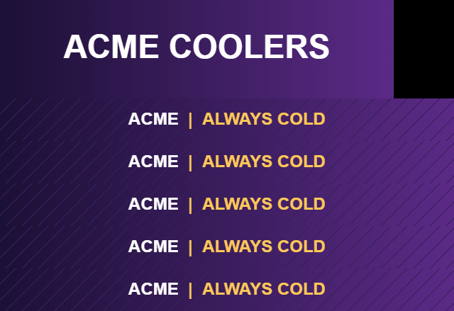

# LED Signage Builder

A small Python + ffmpeg pipeline that builds branded content for LED displays on smart coolers and retail shelves: a header image, an animated shelf-strip video, and a full-canvas video that maps onto the screen layout. It can also merge your content with a partner's video into a **seamless, crossfaded loop** sized for the LED panel.



I built this while setting up LED cooler displays for a trade show, where the content had to share screen time with another advertiser and look sharp on a low-resolution panel.

## What it does

1. **Header**: gradient background with your logo (or brand name) centered.
2. **Shelf strip**: slides of text that glide left with an eased transition over a slowly moving diagonal-line background.
3. **Full canvas**: header and one copy of the strip per shelf, placed at the pixel positions of the physical layout.
4. **Seamless loop (optional)**: partner video, then yours, then back, with 1-second crossfades. The file ends on the same frame it starts on, so when the player restarts the file there's no visible jump. Several cycles go into one file so the player restarts less often.

## Two LED-specific tricks

- **Render at panel resolution.** LED players shrink content to the panel's native resolution (e.g. 480x329) using fast, low-quality scaling, so thin text shimmers. The builder downsamples to the native size itself with area averaging, then scales back up by an exact integer factor with nearest-neighbour. The player's downscale becomes pixel-exact, and the file gets smaller too.
- **Hide the loop seam.** Most players show a black frame when a file restarts. Crossfading back into the first video and packing several cycles into one file makes that moment rare and invisible.

## Usage

```bash
pip install pillow          # plus ffmpeg on your PATH
python build.py examples/config.json --out out
python build.py examples/config.json --out out --loop-with partner.mp4 --cycles 3
```

Outputs: `out/header.png`, `out/shelf.mp4`, `out/canvas.mp4`, and `out/loop.mp4` when `--loop-with` is used.

## Config

Everything lives in one JSON file (see [`examples/config.json`](examples/config.json)):

| Key | What it sets |
| --- | --- |
| `colors` | Gradient (`dark`, `light`), background lines, `text` and `accent` colours |
| `canvas.size` | Full canvas the player maps onto the screen |
| `panel.native_size`, `export_scale` | Physical LED resolution and the integer upscale for export |
| `header.size`, `header.position` | Header image size and placement |
| `shelf.size`, `y_positions` | Strip size and the y offset of each shelf |
| `shelf.slides` | Text slides; each part is `[text, "text" or "accent"]` |
| `shelf.seconds_per_slide` | How long each slide holds |

## Requirements

Python 3.9+, Pillow, ffmpeg/ffprobe.

## License

MIT
